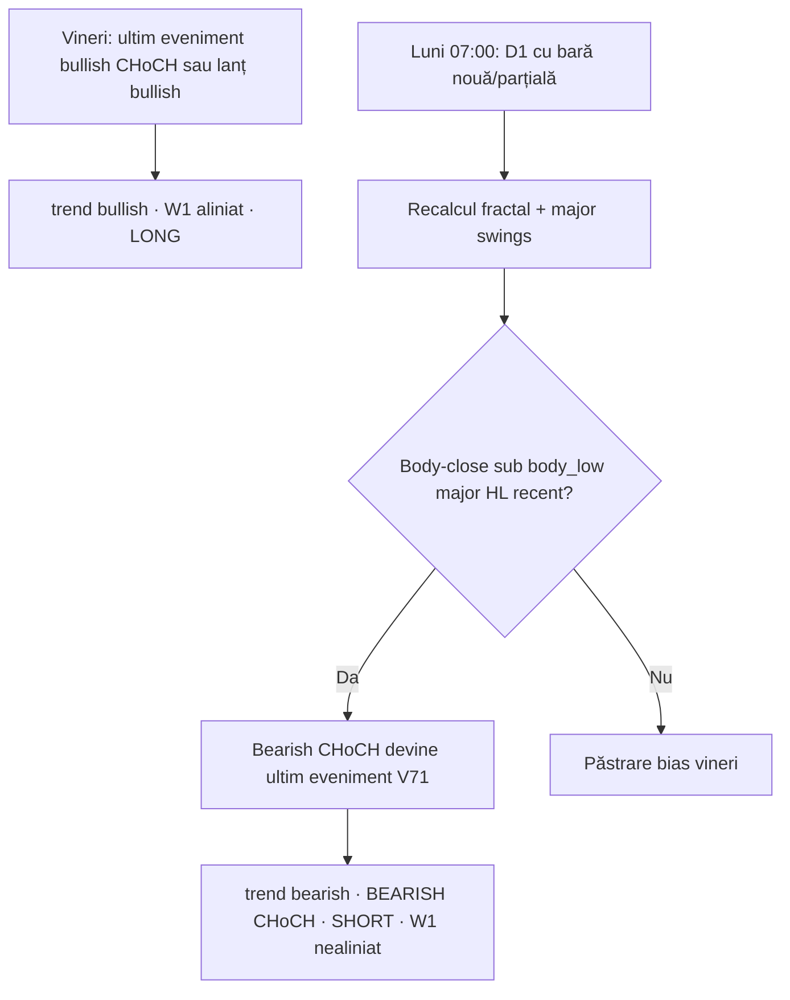

# USDCAD — Diagnostic flip D1: BULLISH CHoCH (vineri) → BEARISH CHoCH (luni)

**Tip:** audit read-only → **remediu implementat V72** (Protected HL/LH + bare D1 închise)  
**Context:** Glitch Matrix V71 / V71.1 + **V72** recalibrare structurală  
**Data raport:** 2026-10-13  
**Simptom observat:**

| Moment | Semnal | Preț (scan) |
|--------|--------|-------------|
| Vineri ~18:52 | `D1: BULLISH CHoCH` · `W1: BULLISH` · LONG | 1.42729 |
| Luni ~07:01 | `D1: BEARISH CHoCH` · `W1 nealiniat` · SHORT | 1.42559 |

Pe Daily, mișcare ~17 pips în consolidare la vârf — fără schimbare macro evidentă pe chart.

---

## 1. Rezumat executiv

Flip-ul **nu necesită** un break de trend swing-trading vizual (săptămâni de structură), ci poate apărea din combinația:

1. **V71 — ultimul CHoCH/BOS cronologic = autoritate D1** (`_resolve_pure_d1_matrix` în `smc_detector/d1_leg.py`).
2. **Eliminarea Rule 2** — body-close sub `body_low` al unui **major swing low** anterior, în uptrend, generează **bearish CHoCH** fără veto „Major LH”.
3. **Bara D1 live (neînchisă)** la autoscan 07:00 + **recalcul fractal** (D1 `FRACTAL_WINDOW = 3`) — lista de pivoturi major poate diferi față de vineri seară.
4. **`filter_internal_range_signals`** — passthrough V71 (nu mai elimină semnale „interne”).

Concluzie practică: la vârf, un **HL major recent** (2–5 sesiuni) spart prin close pe bară parțială poate inversa bias-ul Daily, deși pe chart pare doar consolidare.

---

## 2. Limitări reproducere (workspace local)

| Resursă | Stare |
|---------|--------|
| cTrader `localhost:8010` | Indisponibil local — fără D1 live @ 1.427 |
| `data/historical_cache/USDCAD_D1_*.csv` | Ultima bară ~2026-01-29, close ~1.362 |
| `monitoring_setups.json` | Gol local |
| `data/last_auto_scan.json` | Lipsă local |

**Valorile exacte** pentru luni 2026-10-13 07:01 (`index`, `break_price`, `swing_broken`, OHLC pivot) trebuie extrase pe **VPS** cu scriptul din secțiunea 7.

### Referință cache (300 bare D1, proxy structural)

Pe ultimele 300 bare din cache (prețuri ≠ 1.427):

- Autoritate: **bullish**
- Ultim **bullish CHoCH**: bar **284**, `break_price` **1.39156**, `candle_time` **2026-01-08 22:00:00**
- Exemplu **bearish CHoCH** în istoric: bar **268**, `break_price` **1.37523**, `swing_broken` wick **1.39859** @ bar 249

---

## 3. Pipeline autoritate D1

```
daily_scanner.py
  → get_historical_data(symbol, "D1", lookback ≥ 250, tipic 365)
  → SMCDetector.build_d1_context(df_daily)
       → detect_choch_and_bos(df)
       → filter_internal_range_signals (V71: fără filtrare)
       → _resolve_d1_leg / _resolve_pure_d1_matrix
  → scan_for_setup(..., d1_ctx=...)
  → Telegram / MARKET_REPORT (V71.1: trend aliniat cu latest_signal)
```

**Sursă unică bias:** `build_d1_context()` — `smc_detector/d1_authority.py`.

---

## 4. Ce CHoCH detectează luni? (definiție cod)

`detect_choch_and_bos()` — **doar swing-uri MAJOR** (`filter_major_swings`).

### Bearish CHoCH (flip din bullish)

Condiții (pe lanțul de major lows):

1. Pivot nou major: `swing.price < prev_low.price` (LL față de major low anterior).
2. Între `prev_low.index` și `swing.index`, există bară cu **`close < body_low(prev_low)`**, unde `body_low = min(open, close)` (nu wick).

Eveniment emis:

| Câmp | Semnificație |
|------|----------------|
| `index` / `candle_time` | Bara **noului major LL** (pivot LL) |
| `break_price` | **Wick low** al pivotului (`swing.price`) |
| `previous_trend` | `'bullish'` pentru flip reversal |
| `swing_broken` | **`prev_low`** — major HL al cărui **body** a fost încălcat |

Fragment relevant: `smc_detector/core_structure.py` (ramura `prev_trend == 'bullish'` pe swing low).

### Autoritate V71

Evenimentele CHoCH + BOS se sortează `(index, CHoCH înainte de BOS la același index)`. **Ultimul** setează `trend` și `latest_signal`.

Dacă ultimul eveniment = bearish CHoCH cu `previous_trend='bullish'` → UI: **D1 BEARISH CHoCH**, strategie **reversal**, direcție **SHORT**, W1 poate apărea **nealiniat**.

**Notă:** prețul **1.42559** din card este de regulă **`close` ultimului rând D1** la scan, nu neapărat `break_price` al CHoCH.

### Ipoteză pentru scenariul ~1.427 → ~1.4256

- `swing_broken`: HL major din **ultimele 2–5 zile** (body ~1.424–1.426), nu HL de multi-săptămâni.
- `break_price`: wick major low local sub acel HL (~1.424x–1.425x).
- Confirmare: ~17 pips pot fi suficienți între `body_low` pivot și close parțial luni dimineață.

---

## 5. Micro-swing vs swing structural

| Strat | Regulă |
|-------|--------|
| Fractal D1 | `FRACTAL_WINDOW = 3` — pivot local ~7 zile calendaristice |
| CHoCH/BOS | Doar pivoturi **major** |
| Promovare major | Displacement: body-close după pivot vs body pivot anterior + reguli range (sub-structură în [LL,LH] / [HL,HH] fără breakout) |

**V71 fără Rule 2:** orice **major LL** valid + body-close sub body-ul major HL-ului anterior, cu context uptrend, produce bearish CHoCH — **fără** cerință de spargere Major LH.

**Răspuns la întrebarea audit:** nivelul spart este, în scenarii de vârf, adesea un **HL major recent la consolidare**, nu un HL macro „de carte”. Vizual = micro-dip; pentru cod = **eveniment structural major** dacă pivotul a fost promovat în `major_lows`.

---

## 6. Lumânare D1 neînchisă (forming bar)

| Pas | Comportament |
|-----|----------------|
| `ctrader_cbot_client._dataframe_from_payload` | Toate barele din API → DataFrame, **fără** drop al ultimei bare |
| `daily_scanner` | `df_daily` complet → `build_d1_context()` |

La **07:01 Europe/Bucharest** (luni), bara D1 curentă este **parțială**. Dacă `close` intraday < `body_low` al unui major HL recent, CHoCH bearish se calculează **înainte de închiderea NY**.

**Efect suplimentar:** cu 3 bare la dreapta pentru fractal, **luni** poate confirma un swing low de **joi/vineri** care **vineri 18:52** nu era încă pivot valid → grafic major swings diferit între cele două scanări.

---

## 7. Git, cron, cache (autoscan 07:00)

| Element | Valoare așteptată |
|---------|-------------------|
| Daemon | `auto_scanner_daemon.py` — `cwd = BASE_DIR` (rădăcina repo) |
| Subproces | `python -u daily_scanner.py` |
| Commit structural V71 | `ad089a0` |
| Commit sync Telegram V71.1 | **`bd6dae4`** (HEAD recomandat pe VPS) |
| Loguri | `logs/daily_scanner_subprocess.log`, `logs/auto_scanner.log` |

Verificare VPS (read-only):

```bash
cd "/path/to/trading-ai-agent apollo"
git rev-parse HEAD
tail -200 logs/daily_scanner_subprocess.log | grep -i USDCAD
python3 scripts/audit_structural_classification.py --symbol USDCAD --debug
```

---

## 8. Script — valori exacte CHoCH (VPS + cTrader)

Rulează pe mașina unde **port 8010** servește D1 live:

```bash
cd "/path/to/trading-ai-agent apollo"
python3 << 'PY'
import pandas as pd
from daily_scanner import CTraderDataProvider
from smc_detector import SMCDetector

det = SMCDetector()
dp = CTraderDataProvider()
assert dp.connect(), "cTrader indisponibil"
df = dp.get_historical_data("USDCAD", "D1", 365)
ch, bo = det.detect_choch_and_bos(df)
bear = [c for c in ch if c.direction == "bearish"]
ctx = det.build_d1_context(df, symbol="USDCAD")

print("last_row", df.index[-1])
print("OHLC", df.iloc[-1][["open", "high", "low", "close"]].tolist())
print("AUTH trend", ctx.trend, "d1_signal_type", ctx.d1_signal_type, "strategy", ctx.strategy_type)

if bear:
    c = bear[-1]
    sb = c.swing_broken
    i = sb.index
    bl = min(float(df.open.iloc[i]), float(df.close.iloc[i]))
    print("--- LAST_BEARISH_CHOCH ---")
    print("index", c.index)
    print("break_price", c.break_price)
    print("candle_time", c.candle_time)
    print("previous_trend", c.previous_trend)
    print("swing_broken wick", sb.price, "bar", i, "time", sb.candle_time)
    print("swing_broken body_low", bl)
    print("broken bar OHLC", df.iloc[i][["open", "high", "low", "close"]].to_dict())

df_fri = df.iloc[:-1]
ctx_f = det.build_d1_context(df_fri, symbol="USDCAD")
ch_f, _ = det.detect_choch_and_bos(df_fri)
print("--- FRI_PROXY (fără ultima bară) ---")
print("trend", ctx_f.trend, "close", float(df_fri.close.iloc[-1]))
if ch_f:
    print("last choch in list", ch_f[-1].direction, ch_f[-1].break_price, ch_f[-1].candle_time)
PY
```

Completează tabelul de mai jos cu output-ul VPS:

| Câmp | Valoare (de completat) |
|------|-------------------------|
| `LAST_BEARISH_CHOCH.index` | |
| `break_price` | |
| `candle_time` | |
| `previous_trend` | |
| `swing_broken.price` (wick) | |
| `swing_broken` bar / time | |
| `swing_broken body_low` | |
| FRI_PROXY `trend` (fără ultima bară) | |

---

## 9. Timeline cauzal (vineri → luni)



---

## 10. Legături documentație existentă

- `docs/GLITCH_MATRIX_D1_BIAS_SETUP_DIAGNOSTIC.md` — pipeline bias + V71
- `docs/GLITCH_V71_D1_SYNC_AND_TELEGRAM_FIX.md` — drift trend vs Telegram (V71.1)

---

## 11. Remediu V72 (implementat)

| Regulă | Locație |
|--------|---------|
| D1 structural fără bara live | `d1_closed_structure_df()` → `build_d1_context()` |
| Protected HL = origine impuls bullish (`_leg_origin_major_low`) | `filter_choch_bos_by_protected_swings()` |
| Protected LH = plafon invalidare bearish la bara evenimentului | `_protected_ceiling_bearish_leg_at()` |
| Drop bearish post-flip bullish dacă `close` nu sparge HL protejat | după ultimul CHoCH flip adevărat |
| Scanner: preț live din `df` complet, bias din context V72 | `daily_scanner.py` (comentariu V72) |

Teste: `tests/test_d1_protected_swings_v72.py`.

---

*Generat din analiza USDCAD (flip vineri/luni). Secțiunea 8 — completare opțională cu output VPS.*
